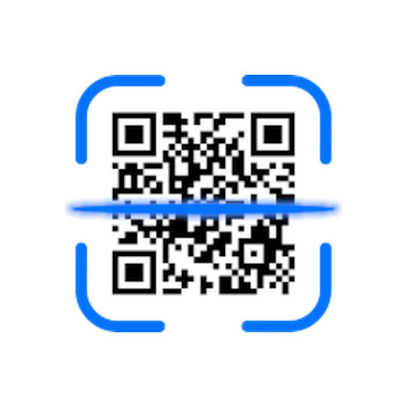
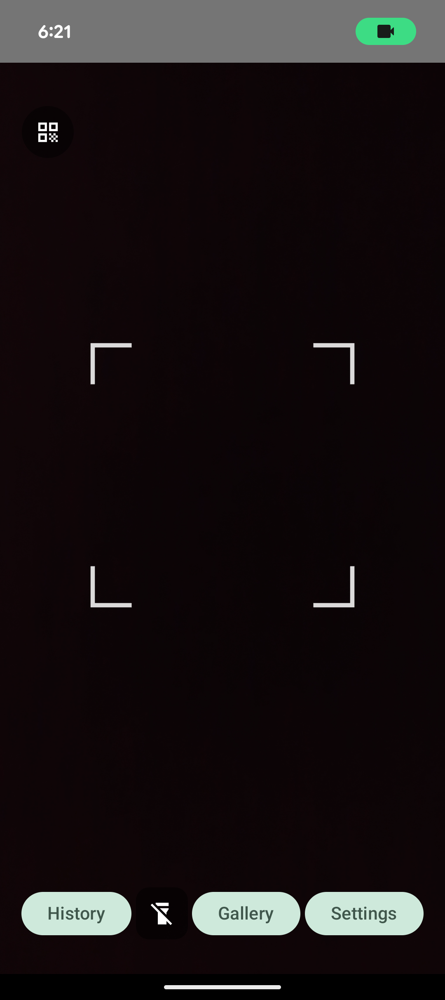
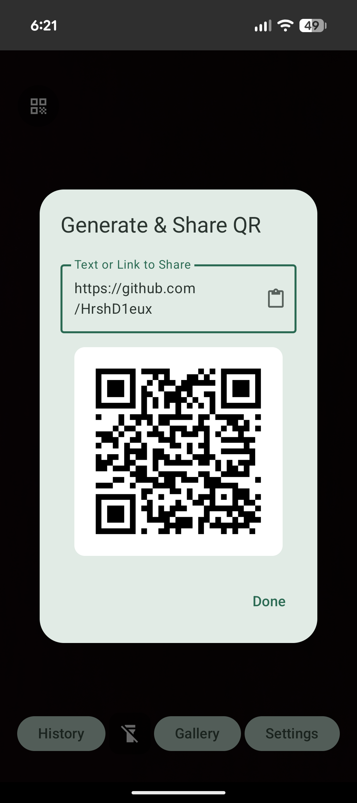
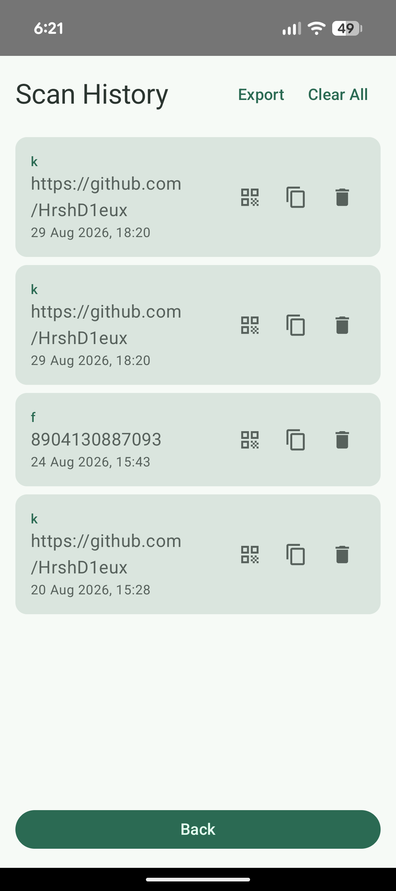
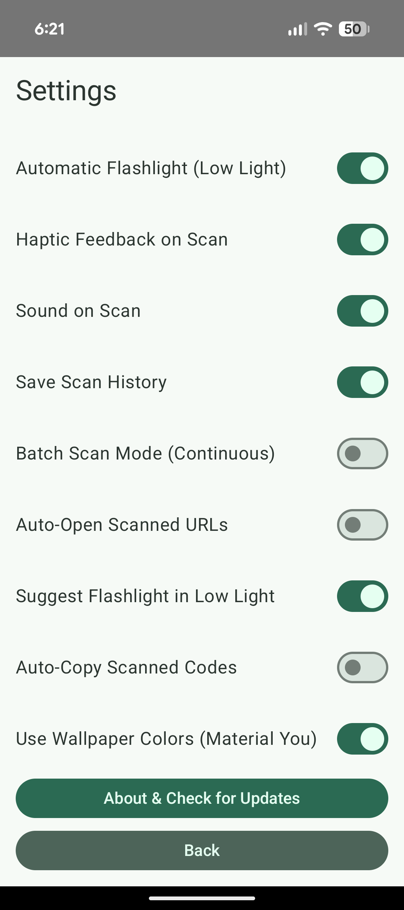

<p align="center">
  
</p>

<h1 align="center">Scan</h1>

<p align="center">
  <strong>A lightweight, privacy-first Android QR and barcode scanner.</strong><br>
  Built with Jetpack Compose, CameraX, and Google ML Kit.
</p>

<p align="center">
  <a href="https://github.com/HrshD1eux/Scan/releases/latest"></a>
  <a href="https://hrshd1eux.github.io/Scan/"></a>
  <a href="PRIVACY.md"></a>
  <a href="https://github.com/HrshD1eux/Scan/blob/main/LICENSE"></a>
</p>

---

## Overview

Scan starts directly into the viewfinder without startup lag or ads. It detects multiple barcode formats on-device, classifies content into actionable types (UPI payments, URLs, Wi-Fi credentials, vCards, SMS, coordinates, OTPs), and triggers corresponding native Android system handlers.

## Screenshots

<p align="center">
  
  
  
  
</p>

### Key Features

- **Instant Viewfinder:** Powered by CameraX `ImageAnalysis` operating at 1080p with continuous frame debounce, pinch-to-zoom, and tap-to-focus.
- **Actionable Searchable History:** Real-time search, dynamic auto-filter chips (URLs, UPI, Wi-Fi, Products, Contacts), direct one-tap action dispatch from history cards, and CSV export.
- **Offline QR Studio:** Generate structured QR codes for Wi-Fi networks, UPI payments, vCards/contacts, or plain text with one-tap "Save PNG to Gallery" and "Share QR Image".
- **Continuous Batch Scanning HUD:** Dedicated inventory batch mode with floating on-screen item counter and audio/haptic feedback without leaving the camera.
- **Private Incognito Mode:** One-tap viewfinder incognito toggle ensuring zero disk writes to history for sensitive scans, alongside configurable history auto-purge (7/30/90 days).
- **Privacy-First Product Search:** Configurable barcode lookup defaulting to DuckDuckGo, Open Food Facts, Amazon, or custom URL templates.
- **Deep Intent Routing:** Native dispatch for UPI payments, Wi-Fi configuration (`WifiNetworkSuggestion`), contacts, navigation, and web URLs via Chrome Custom Tabs.
- **Low-Light Assistant:** Ambient light sensor integration with automatic torch activation or pulse suggestion.
- **Gallery & Share Sheet:** Scans images directly from the gallery or incoming Android share intents.
- **System Integration:** Android Quick Settings Tile and App Shortcuts for instant access.

---

## Architecture

The project adheres to modern Android engineering best practices:

- **UI Layer:** Jetpack Compose with Material 3 theming (supports Dynamic Color / Material You on Android 12+).
- **State Management:** `MainViewModel` utilizing Kotlin Coroutines and `StateFlow` for unidirectional data flow.
- **Vision Pipeline:** Google ML Kit barcode vision pipeline with ZXing fallback encoders.
- **Storage:** Room Database for persistent scan records and Jetpack DataStore Preferences for user configuration.

---

## Project Structure

```
app/src/main/java/com/HrshD1eux/Scan/
├── MainActivity.kt        # Entry point and Compose root
├── MainViewModel.kt       # Application state and scan event handling
├── ScanTileService.kt     # Android Quick Settings tile
├── actions/               # Intent creation and system action dispatchers
├── camera/                # CameraX analyzer, preview, and sensor managers
├── history/               # Room entities, DAO, migrations, and CSV export
├── parser/                # ML Kit barcode classification and content models
├── scanner/               # Multi-item sliding LRU duplicate debounce
├── ui/                    # Jetpack Compose UI screens, components, and theme
├── updater/               # In-app update manager and package installer
└── utils/                 # QR matrix generator utilities
```

---

## Build & Testing

### Prerequisites
- Android Studio Iguana / Jellyfish or newer
- JDK 17
- Android SDK 34 (minSdk 24)

### Running Unit Tests
```bash
./gradlew testDebugUnitTest
```

### Building APK
```bash
./gradlew assembleDebug
```

---

## Privacy

Scan is engineered from the ground up to be **100% on-device with zero trackers, zero analytics, and zero advertising**. Camera frames are processed strictly in volatile device memory and discarded immediately. No data is ever transmitted to remote servers. See the complete [Privacy Policy](PRIVACY.md) for details.

---

## License & Ownership

Copyright &copy; 2024&ndash;2026 **HrshD1eux**. All rights reserved.

This project is free software licensed under the **GNU General Public License v3.0 (GPL-3.0)** with an explicit Section 7 linking exception for Google Play Services / ML Kit, Android Jetpack, and ZXing runtime libraries. See the [LICENSE](LICENSE) file for the full legal text.

---

## Legal Notices & Trademarks

- **QR Code** is a registered trademark of **DENSO WAVE INCORPORATED** in Japan and other countries.
- **Android**, **Google Play**, **Google Maps**, and **ML Kit** are trademarks of **Google LLC**.
- **UPI** is a registered trademark of the **National Payments Corporation of India (NPCI)**.
- All other trademarks, service marks, and company names are the property of their respective owners.
- **Disclaimer:** Scan is an independent open-source project and is not affiliated with, sponsored by, or endorsed by Google LLC, DENSO WAVE INCORPORATED, NPCI, or any payment provider. The software is provided "AS IS", without warranty of any kind.
